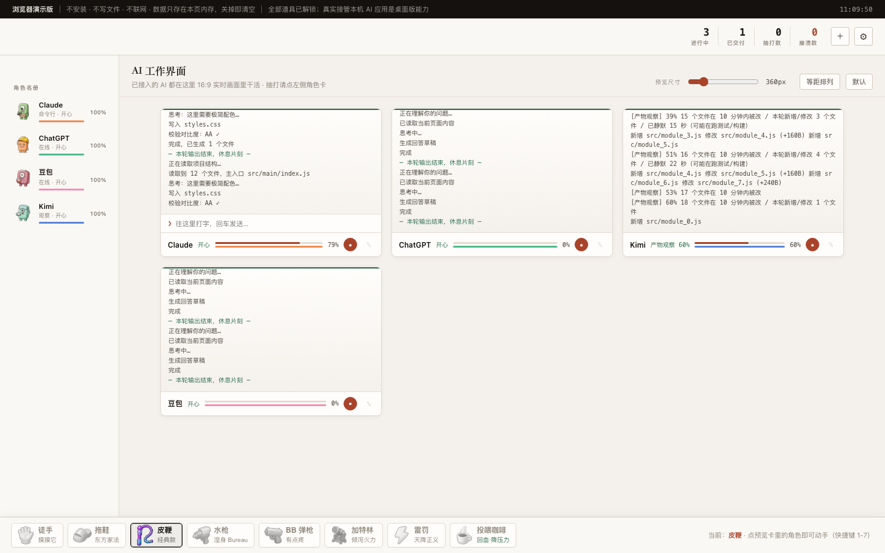

# 🐾 破蛋-网页窗口合集 · Begg - Web Window Collection

把 Claude / ChatGPT / Gemini / Midjourney / ComfyUI / Cursor / Kimi / 豆包 等 AI 应用，
变成**圆润软糖风**的卡通打工仔。抽打**不会改变** AI 的真实产出速度，
但被打的 AI 会求饶、会哭、会崩溃、会复活——纯纯的情绪价值。

**English**: Begg - Web Window Collection turns your AI apps into jelly-like workers you can "whip" while they work. Whipping doesn't make them faster — but they will beg, cry, crash, and come back to life. This repo hosts the **open-source browser demo**; the desktop app is closed-source.

## ▶ 在线试玩（免安装）

仓库已启用 GitHub Pages，打开首页即可玩，**不联网、不写文件、数据只存本页内存**：

> https://liuuyuu.github.io/begg-web-window-collection/

本地跑也一样（纯静态，无构建步骤）：

```bash
python3 -m http.server 8765
# 浏览器打开 http://127.0.0.1:8765/h5/index.html
```

## 📸 它长这样



## ✨ 新手 30 秒上手

| 想做什么 | 怎么做 |
| --- | --- |
| 收起左侧栏，画面更大 | 左上角 **‹** |
| 接入新的 AI 角色 | 左侧栏的 **＋** |
| 编辑角色（改名 / 换形象） | **右键**角色卡 |
| 抽打角色 | 底部道具栏选道具 → 点角色（快捷键 **1-7**） |
| 监视窗调大小 / 铺满 | 右上角滑块；**2列 / 3列 / 4列** 一键铺满 |
| 单看放大某个 AI | 徒手状态下**点角色卡**；「显示所有」退出 |
| 调整监视卡顺序 | **长按**卡片顶部标签条空白处拖动 |
| 随机抽打 / 快速派活 | **空格** / **⌘N** |

> 💡 以上小技巧也会常驻在应用底部的黑色滚动条里滚动提示，忘了随时看一眼。

## 🧱 这个开源部分包含什么

- **真实引擎** `src/main/engine.js` —— 桌面版同源的任务状态机、角色生命体征、抽打逻辑，
  通过一层极简 CommonJS 桥（`h5/runtime.js`）直接在浏览器里运行，不是录屏也不是假数据
- **角色系统** `src/shared/` —— 12 个内置角色的设定、配色、配件，以及运行时角色注册表
- **渲染层** `src/renderer/` —— SVG/位图角色立绘、Canvas 命中特效、WebAudio 合成音效、求饶台词库
- **演示外壳** `h5/` —— 浏览器版主进程替身：预置演示会话、模拟流式输出与产物观察

浏览器演示版**刻意不包含**的东西（它们只在闭源桌面版里）：

| 能力 | 说明 |
| --- | --- |
| 真实应用接管 | 扫描本机已装的 AI 应用、内嵌网页版、桌面窗口捕获 |
| 终端会话 | 本地 CLI 子进程双向流、CDP 读取桌面应用 |
| 原生输入注入 | macOS 辅助功能链路（Swift 桥 + 原生 addon） |
| 授权与支付 | 兑换码、许可证校验、支付云函数 |

这样切分的原因很直接：**能操作别人电脑的代码不适合开源**——
它被 fork 成远控工具只是时间问题，而锅会落在作者头上。

## 🖥 桌面完整版（闭源）

桌面版在开源演示版之上增加：真实接管本机 AI 应用与网页版、终端会话流、
按产物推断的真实进度、鼠标捕获、更多道具与付费解锁。

→ **[点此到 123 网盘下载](https://1829523080.share.123pan.cn/123pan/bsncjv-r4r4?pwd=NKsN)**（macOS / Windows 双版本，提取码 `NKsN`）。

## 🧩 目录结构

```
├── index.html            # 落地页
├── h5/
│   ├── index.html        # 演示版页面
│   └── runtime.js        # 浏览器版主进程替身（CommonJS 桥 + 演示会话）
├── src/
│   ├── main/engine.js    # 任务引擎（与桌面版同源）
│   ├── shared/           # 角色定义 + 运行时注册表
│   └── renderer/         # 界面、立绘、特效、音效、台词
└── docs/                 # 截图等资料
```

## 📝 自定义你的角色

角色、台词、配色、配件全在代码里，零美术资源依赖：

- 角色设定与配色：`src/shared/characters.js`
- 求饶台词库（四种基调随机）：`src/renderer/js/voices.js`
- 立绘渲染：`src/renderer/js/characters.js`
- 命中特效：`src/renderer/js/effects.js`

改完刷新浏览器即可，无构建步骤。欢迎 PR 新角色与新台词。

## 📄 许可

本仓库的演示版代码以 [MIT](LICENSE) 许可开源。

桌面完整版为专有软件，保留所有权利：禁止复制、再分发、反编译或绕过其授权机制。

---

*免责声明：本项目纯属娱乐。抽打你的 AI 不会让它们变快，也不会让它们受伤（大概）。*
